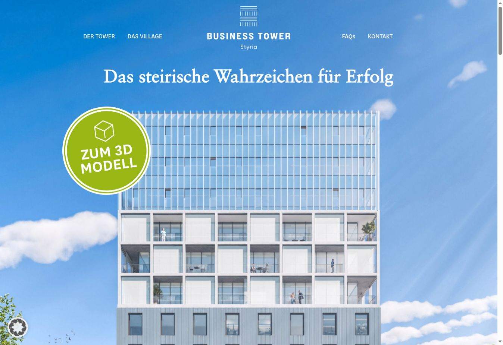

# Business Village Styria – Struktur und Übertragung auf TEICHWIESE

Stand: 15. November 2026. Quellen: [Startseite](https://business-village-styria.at/), [Village](https://business-village-styria.at/business-village/), [FAQ](https://business-village-styria.at/faq/), [Kontakt](https://business-village-styria.at/kontakt/). Untersucht wurden öffentlich sichtbare Inhalte, Navigation, Desktopdarstellung und CSS-Schriftangaben. Kein Formular wurde abgeschickt.

## 1. Informationsarchitektur

Die Domain führt auf die Tower-Präsentation. Das Gesamtareal erhält eine eigene Village-Seite. Die Trennung beschreibt zwei Angebote unter einer gemeinsamen Marke. Die Hauptnavigation ist flach; die rechtlichen Links liegen im Footer.

| Bereich | URL-Pfad | Aufgabe |
|---|---|---|
| Der Tower / Start | `/` | Gebäudebezogener Einstieg und Vermarktung |
| Das Village | `/business-village/` | Einordnung des Areals und Nutzungsspektrums |
| FAQs | `/faq/` | Fragen und Einwände klären |
| Kontakt | `/kontakt/` | Interessenten zur Anfrage führen |
| Impressum | `/impressum` | Im Footer verlinkt; nicht inhaltlich geprüft |
| Datenschutz | `/datenschutz` | Im Footer verlinkt; nicht inhaltlich geprüft |
| Disclaimer | `/disclaimer` | Im Footer verlinkt; nicht inhaltlich geprüft |

Im Desktop-Header steht das Logo zentral zwischen zwei Navigationsgruppen. Die Navigation wird im Footer wiederholt. Der Einstiegsbereich der Startseite enthält zusätzlich einen auffälligen Link zu einer externen 3D-Ansicht; deren Anwendung wurde nicht geprüft.

## 2. Seiten und Module

### Startseite: vom Bild zur Anfrage

Die Modulfolge ist: bilddominanter Einstieg mit Claim → farbiger Fakten-/Einleitungsteil → Nutzung und Alltag → vier Angebotsmerkmale → Energie-Konzept mit vier Merkmalen → Projektmeilensteine → Bilderkarussell → Stimmen zum Projekt → Kontaktformular → Footer. Diese Reihenfolge verbindet Atmosphäre, Erklärung, Nachweise und Handlung. Die Projekttermine sind auf der Seite nicht konsistent: Einleitung und Zeitachse nennen unterschiedliche Fertigstellungsjahre. Für Teichwiese sollten Termine zentral gepflegt werden.

### Village: ergänzende Angebotsseite

Die Village-Seite erläutert das Areal und die mögliche Nutzung. Danach folgen vier Angebotsmerkmale, das Energie-Modul sowie Galerie und Stimmen. Viele Bausteine entsprechen der Startseite. Das erleichtert Wiedererkennung, verlängert aber auch die Lektüre. Ein eigener Seitenbereich ist sinnvoll, wenn Teichwiese später tatsächlich verschiedene Gebäude oder deutlich unterschiedliche Angebote erklären muss.

### FAQ: ausführliche Antworten

Acht Themen behandeln unter anderem die Einordnung des Gebäudes, Nutzung, Standort, Infrastruktur, Energie und den Weg zur Anfrage. In der beobachteten Desktopansicht sind die Antworten offen unter den Fragen sichtbar, kein zu bedienendes Accordion. Danach folgen erneut Galerie und Stimmen. Für Teichwiese bietet sich eine kürzere FAQ mit konkreten Fragen zu verfügbaren Einheiten an.

### Kontakt: kurze Abschlussstrecke

Ein Innenraumbild steht vor der Einleitung; darunter folgt ein grüner Formularbereich. Das Formular bietet Name, Firma, Telefon, E-Mail und Nachricht. Eine Telefonnummer ist zusätzlich sichtbar. Die tatsächlich serverseitig erforderlichen Felder, Versandfunktion, Fehlerbehandlung und Datenschutzkonfiguration wurden nicht getestet.

## 3. Visuelles System – eigene Beobachtung

| Merkmal | Beobachtung | Nutzen für Teichwiese |
|---|---|---|
| Bildsprache | Grossflächige Architekturvisualisierungen, Aussen- und Innenraumansichten | Gebäude als Hauptmotiv statt austauschbarer Stockfotos |
| Farben | Weiss und Grau als Basis; leuchtendes Gelbgrün als Flächen- und Aktionsfarbe | Eigene Logo-Farben Grün/Gold verwenden |
| Typografie | Hero-H1 laut CSS `Linotype - SabonLTStd-Roman`; weitere geprüfte Überschriften und Absätze `National` | Schriftkontrast ist ein Prinzip, kein Anlass zur Übernahme fremder Fontdateien |
| Schriftgrössen | Am geprüften Desktop ca. 48,6 px Hero, 26 px H2, 18 px Fliesstext | Grössen im eigenen responsiven System definieren |
| Inhaltsbreite | Zentrierte, begrenzte Textbereiche innerhalb breiter Abschnitte | Lesbarkeit bei grossen Bildflächen |
| Formen | Einzelne grosse runde Abschnittsecken, abgerundete Eingabefelder | Sparsam eingesetzte Rundungen passen zur Landschaft im Logo |
| Galerie | Bildkarten mit Beschreibung, Pagination; Sliderstrukturen im DOM | Einfache Galerie zunächst ausreichend |
| Stimmen | Portrait, Zitat, Urheber und Slidersteuerung | Nur mit echten freigegebenen Referenzen einsetzen |
| Footer | Heller Graubereich mit Standort, Kontakt und Navigation | Schlanker, klar strukturierter Abschluss |

Im DOM sind WordPress-/Divi-typische Klassen und Swiper-Container vorhanden; der ausgelesene Footer nennt WordPress und Elegant Themes. Das beschreibt die beobachtete Implementierung, begründet aber keine entsprechende Technologieentscheidung für Teichwiese.

## 4. Bewertung und bewusst andere Entscheidungen

**Stärken:** starke Bildwirkung; überschaubare Navigation; wiederkehrende Gestaltung; klare Verbindung von Projektargumenten und Kontakt.

**Verbesserungsmöglichkeiten für Teichwiese:** direkter Kontakt- oder Flächen-CTA schon im Einstieg; kürzere Abschnitte; konkrete, bestätigte Flächenangaben statt allgemeiner Superlative; weniger wiederholte Slider; FAQ auf die tatsächlichen Interessentenfragen zuschneiden. Auf mobile Bedienung, Kontrast, sichtbare Formularlabels und Tastaturbedienbarkeit achten. Eine umfassende Barrierefreiheitsprüfung der Referenz wurde nicht durchgeführt.

Die lange Tower-Visualisierung dominiert den ersten Bildschirm. Für Teichwiese sollte die erste Handlung ohne langes Scrollen erreichbar sein. Animationen sind optional; wichtige Informationen müssen auch ohne Animation sichtbar bleiben.

## 5. Vorgeschlagene Struktur für Teichwiese

Dies ist ein eigener Entwurf, keine Beschreibung bereits bestätigter Projektangebote.

| Abschnitt | Inhalt | Noch benötigte Fakten |
|---|---|---|
| Einstieg | Logo, starke Ansicht, kurzer Nutzen, Flächen-CTA | Finaler Claim |
| Projekt | Kurzbeschreibung und drei belegte Vorteile | Nutzungen, Projektstatus |
| Flächen | Einheiten als Karten oder Tabelle | Grössen, Teilbarkeit, Verfügbarkeit, Preisangaben falls gewünscht |
| Lage | Adresse, Anreise, Umgebung | Bestätigte Adresse und belastbare Anreisezeiten |
| Einblicke | Vorhandene 3D-Ansichten und ggf. Fotos | Aktueller Bildstand und Freigaben |
| FAQ | Ausbau, Termine, Parken, Besichtigung | Bestätigte Antworten |
| Kontakt | Ansprechpartner und einfache Anfrage | Öffentliche Kontaktdaten und Formularziel |

Für die erste Website reicht eine Seite mit Sprungnavigation. Die Varianten-Auswahl ist eine separate Entwurfsübersicht, nicht Bestandteil einer späteren Vermietungsseite. Alle Varianten verwenden gemeinsame Bilder, Logo und Schrift; nur Layout und Präsentation ändern sich.

Vorlagen: [Landingpage](../../templates/landingpage-inhalt.md) und [Flächen, FAQ und Kontakt](../../templates/flaechen-faq-kontakt.md).

## 6. Screenshot-Inventar und Grenzen

Alle Aufnahmen wurden am 15.11.2026 im Desktop-Cloud-Browser erstellt, CSS-Viewport laut Browser 1363 × 936. JPEG-Bildbreite kann wegen Scrollbar und Aufnahmeschnitt abweichen. Kein Mobiltest. Vollseitenaufnahmen können durch Lazy Loading oder Eintrittsanimationen leere Bereiche enthalten; sie sind keine lückenlose Archivkopie. Sichtbare Struktur und DOM wurden gemeinsam zur Einordnung genutzt.

| Datei | Zweck |
|---|---|
| [01-tower-hero.jpg](screenshots/01-tower-hero.jpg) | Header, Claim, Architekturmotiv und 3D-Link |
| [02-tower-full.jpg](screenshots/02-tower-full.jpg) | Gesamte Seitenlänge und Modulabfolge |
| [03-village-full.jpg](screenshots/03-village-full.jpg) | Vergleich zur Arealseite |
| [04-faq-full.jpg](screenshots/04-faq-full.jpg) | Fragenstruktur und wiederverwendete Module |
| [05-kontakt-full.jpg](screenshots/05-kontakt-full.jpg) | Bildeinstieg, Formular und Footer |

Screenshots dienen als Referenzmaterial zur Analyse; keine Übernahme der fremden Marke, Texte, Bilder oder Fonts in die Teichwiese-Website. Sie liegen im Repository ausserhalb von `docs/` und werden nicht mit GitHub Pages ausgeliefert. Das Repository selbst ist öffentlich.
